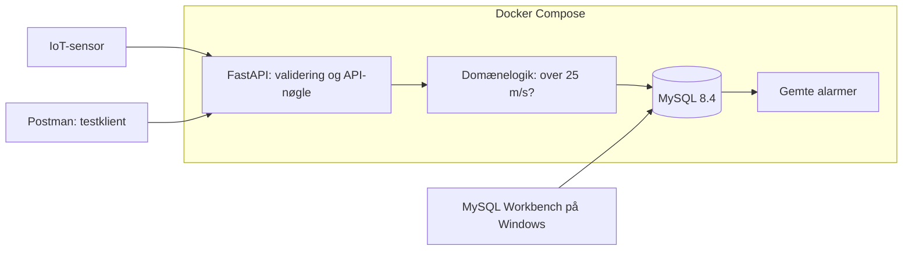

# Intelligent IoT API

## Kort fortalt — sådan læser du løsningen

**Du sender en måling → API'et kontrollerer den → MySQL gemmer resultatet → SQLTools viser tabellerne.**

- **Postman:** Her sender du en vindmåling til API'et.
- **FastAPI:** Modtager og validerer målingen. Over 25 m/s giver en alarm; præcis 25 m/s gør ikke.
- **MySQL:** Gemmer målinger, hændelser og alarmer permanent.
- **Docker:** Kører API og MySQL. Lad Docker Desktop køre, når du bruger projektet.
- **SQLTools i VS Code:** Viser de data, der ligger i MySQL. Workbench er valgfrit.

### Hvad betyder tabellerne og felterne?

| Tabel/felt | Betydning |
| --- | --- |
| `sensor_readings` | De modtagne sensormålinger. |
| `device_id` | Hvilken installation målingen kommer fra. |
| `wind_speed` | Vindhastighed i meter pr. sekund. |
| `anomaly_detected` | Sand/1 betyder, at værdien var over 25 m/s. Falsk/0 betyder normal. |
| `domain_events` | Hvad systemet gjorde: modtog måling, fandt afvigelse, oprettede eller kvitterede alarm. |
| `reading_id` | Nummeret på målingen, som hændelsen/alarmen hører til. |
| `alarms` | Alarmer til driftspersonalet. `active` betyder aktiv; `acknowledged` betyder kvitteret. |
| `created_at` | Oprettelsestidspunkt i UTC. |

### Se tabellerne igen

Forbindelsen hedder nu **Intelligent IoT - MySQL (nyt login)**. Navnet er ændret efter passwords-skiftet for at undgå et gammelt gemt login.

1. Tryk **Ctrl+Shift+P → SQLTools: Connect** og vælg forbindelsen.
2. Hvis der kommer et loginspørgsmål, tillad det og indsæt værdien fra `MYSQL_PASSWORD` i `.env` i passwordfeltet. Kopiér kun efter `=` og del ikke værdien.
3. I SQLTools-panelet udvider du forbindelsen → databasen → **Tables**.
4. Højreklik på `sensor_readings` → **Show Table Records**.
5. Gør det samme for `domain_events` og `alarms`. Klik **RE-RUN QUERY** for at opdatere data efter en ny måling.

Databasepasswordet er skiftet efter at være blevet delt. API-nøglen er uændret, så dine Postman-requests skal ikke ændres af den grund. Data og den gamle SQLite-backup er bevaret.


REST API til IoT-overvågning og Managed Services for den fiktive virksomhed **Intelligent IoT Solutions A/S**. Studieprojekt på Økonomi & IT, 6. semester.

API'et gemmer vindmålinger, registrerer overskridelser af **25 m/s** og opretter alarmer til kontrolcentret. Formålet er at understøtte hurtig reaktion og reducere risikoen for nedetid. Dette er en regelbaseret MVP, ikke en AI-model, der forudsiger maskinfejl.

## Status — 11. november 2026

- Den eksisterende FastAPI-løsning er udbygget med MySQL-understøttelse og `/health`.
- **40 automatiske tests består med separate SQLite-testdatabaser.** Der er én deprecation-advarsel fra Starlettes testklient om httpx.
- Dockerfile og Compose til FastAPI + MySQL 8.4 er bygget og startet. Integrationstest har verificeret 15/25/30 m/s via HTTP og direkte SQL, inklusive persistens efter genstart af begge containere.
- MySQL Workbench, Docker Desktop og WSL er installeret. Docker engine svarer, Compose-konfigurationen validerer, og begge services er startet. Grafisk visning af data i Workbench mangler endnu at blive bekræftet.
- `main` er forbundet med `https://github.com/Abdel047/Intelligent-IoT-API.git`. MySQL/Docker-løsningen og CI er uploadet i commit `ad444b1`; den tilhørende CI-kørsel er grøn. De seneste LAN/CD-ændringer afventer en ny godkendt upload.
- Den gamle `iot.db` er bevaret som backup. Historiske målinger er ikke flyttet til MySQL.

## Teknologi og arkitektur

Python 3.13, FastAPI, Pydantic, SQLAlchemy, Uvicorn, PyMySQL, MySQL 8.4, Docker Compose, Postman og pytest.

**MySQL er databaseserveren**, som gemmer data. **MySQL Workbench er et grafisk program på Windows**, der forbinder til serveren og viser tabellerne. Workbench starter ikke selv MySQL-containeren.



En gyldig måling giver `SensorValueReceived`. Over 25 m/s følger `AnomalyDetected` og `AlarmCreated`. Ved kvittering gemmes `AlarmAcknowledged`. Ugyldigt input afvises før lagring. Events er databaseposter, ikke en ekstern beskedkø.

## 1. Start med Docker

Åbn projektmappen i VS Code og en PowerShell-terminal. På den nuværende computer er den:

```text
C:\Users\Bruger\OneDrive\Desktop\Intelligent-IoT-API
```

Første gang på en ny computer:

```powershell
python -m venv .venv
.\.venv\Scripts\python.exe -m pip install -r requirements-dev.txt
.\.venv\Scripts\python.exe scripts/prepare_env.py
```

På den nuværende computer er miljø og `.env` allerede klargjort. Scriptet udfylder kun manglende/tomme værdier og bevarer eksisterende nøgler og passwords.

**Forudsætning:** Docker Desktop skal være installeret og køre med Linux-containere. På Windows kan WSL2 og aktiveret virtualisering være nødvendigt. Hvis installationen kræver genstart, gem dit arbejde og genstart manuelt. Projektet genstarter ikke Windows automatisk.

Stop en eventuel lokal Uvicorn-server, som bruger port 8000. Kør derefter:

```powershell
docker compose up --build -d
docker compose ps
```

Første start kan tage flere minutter. `mysql` og `api` skal blive `healthy`.

- API: http://localhost:8000
- Swagger: http://localhost:8000/docs
- Health: http://localhost:8000/health

Et fungerende health check svarer `{"status":"ok","database":"connected"}`. API'et venter ved første opstart på MySQL-healthcheck. API'et bruger ikke root-brugeren.

### Daglig drift og persistens

```powershell
docker compose stop
docker compose start
```

Eller genstart begge services med `docker compose restart`. Volume `mysql_data` gemmer MySQL-data uafhængigt af containerne. `docker compose down` fjerner containere og netværk, men bevarer som standard det navngivne volume. **Brug ikke `docker compose down -v`**, hvis du vil bevare data.

MySQL opretter bruger/database ved første initialisering af et tomt volume. At ændre password i `.env` ændrer ikke et allerede eksisterende MySQL-password. Slet ikke volumen som løsning; planlæg et passwords-skift i databasen.

## 2. Hemmeligheder og konfiguration

`.env.example` indeholder kun feltnavne og ufølsomme standardværdier. Rigtige værdier ligger lokalt i `.env`, som ikke må deles. Docker Compose læser `.env` automatisk til variabelsubstitution; lokal Uvicorn gør ikke.

| Variabel | Formål |
| --- | --- |
| `API_KEY` | Headeren `X-API-Key`; mindst 32 tegn. |
| `MYSQL_DATABASE` | Standard `intelligent_iot`. |
| `MYSQL_USER` | Dedikeret bruger, standard `iot_user`. |
| `MYSQL_PASSWORD` | Brugerens lokale password. |
| `MYSQL_ROOT_PASSWORD` | Separat password til databaseadministration. |
| `MYSQL_PUBLISHED_PORT` | Windows-port til MySQL, standard 3306. |
| `API_PORT` | Windows-port til API'et, standard 8000. |

Compose giver API'et `MYSQL_HOST=mysql` på det interne Docker-netværk. Workbench bruger derimod `127.0.0.1`. SQLAlchemy bygger forbindelsen med `URL.create`, så specialtegn i passwords håndteres korrekt.

MySQL-porten og den almindelige API-port bindes kun til localhost. Den valgfrie LAN-konfiguration tilføjer HTTPS på en privat netværksadresse. Der er ingen router-forwarding eller offentlig internet-deployment. Brug ikke `.env`, private Postman-eksporter eller `docker compose config` med udfyldte hemmeligheder i screenshots eller afleveringer.

## 3. Se data i MySQL Workbench

Når Docker-services er sunde:

1. Åbn MySQL Workbench. Ved **Database Connections** klikker du **+**.
2. Vælg en almindelig MySQL TCP/IP-forbindelse.
3. Udfyld:

   | Felt | Værdi |
   | --- | --- |
   | Connection Name | `Intelligent IoT lokal` |
   | Hostname | `127.0.0.1` |
   | Port | `3306` eller din `MYSQL_PUBLISHED_PORT` |
   | Username | Værdien af `MYSQL_USER` i `.env` |
   | Password | Værdien af `MYSQL_PASSWORD` i `.env` |
   | Default Schema | `intelligent_iot` eller din `MYSQL_DATABASE` |

4. Klik **Test Connection** og gem forbindelsen. I den nyere Workbench-version kan feltnavnene variere lidt; brug de samme forbindelsesværdier.
5. Åbn forbindelsen. Find databasen under **Schemas** og udvid **Tables**. Opdatér objektlisten, hvis tabellerne ikke vises med det samme.
6. Åbn en SQL-fane og kør:

```sql
USE intelligent_iot;
SELECT * FROM sensor_readings ORDER BY id DESC;
SELECT * FROM domain_events ORDER BY id DESC;
SELECT * FROM alarms ORDER BY id DESC;
```

SQL'en findes også i `docs/inspect_mysql.sql`. Send derefter en ny måling fra Postman og kør SELECT igen. Et allerede vist resultat opdaterer ikke sig selv.

Workbench er installeret. MySQL svarer på localhost:3306, og direkte SQL-læsning med projektets databasebruger er verificeret. Den grafiske forbindelse i Workbench skal stadig åbnes og bekræftes.

## 4. Postman og Swagger

Importér `postman/Intelligent-IoT.postman_collection.json`. Den delbare fil indeholder **ingen API-nøgle**. Sæt collection-variablen `api_key` til den lokale værdi fra `.env` og `base_url` til `http://localhost:8000`. Alle datarequests arver headeren `X-API-Key` fra collectionen. Undlad at synkronisere/eksportere den udfyldte nøgle.

Hvis filimport fejler i VS Code-udvidelsen, opret en almindelig HTTP-request og sæt headeren manuelt. Den eksisterende lokale private collection opdateres ikke automatisk ved fremtidige nøgleskift.

I Swagger klikker du **Authorize**, indsætter nøglen og bruger **Try it out → Execute**.

### Eksempel: måling med alarm

POST `http://localhost:8000/readings`, Body → raw → JSON:

```json
{
  "device_id": "WT-01",
  "wind_speed": 30
}
```

Forvent **201 Created**, `anomaly_detected: true`, ID og UTC-tidspunkt. Kontrollér `/events`, `/alarms` og tabellerne i Workbench.

Send derefter `{"device_id":"WT-02","wind_speed":15}`. Den gemmes, men giver ingen alarm. Præcis **25 m/s** er også normal. Negative værdier giver **422** uden lagring.

### Endpoints

| Metode | Endpoint | Formål | Nøgle |
| --- | --- | --- | --- |
| GET | `/` | Enkel information | Nej |
| GET | `/health` | Kontrol af API og database | Nej |
| GET | `/docs` | Swagger-dokumentation | Nej |
| POST | `/readings` | Gem og kontrollér måling; 201 | Ja |
| GET | `/readings` | Alle målinger | Ja |
| GET | `/events` | Domænehændelser i ID-rækkefølge | Ja |
| GET | `/alarms` | Aktive alarmer | Ja |
| GET | `/alarms?status=all` | Hele alarmhistorikken | Ja |
| GET | `/alarms?status=acknowledged` | Kvitterede alarmer | Ja |
| PATCH | `/alarms/{alarm_id}/acknowledge` | Kvittér uden body | Ja |

Manglende/forkert nøgle giver **401**, ukendt alarm giver **404**, ugyldigt input giver **422**, og databasefejl giver **503** uden interne databaseoplysninger. Kvittering betyder, at alarmen er set, ikke at problemet er repareret. Gentaget kvittering giver ikke ekstra events.

## 5. Databasedesign

| Tabel | Felter |
| --- | --- |
| `sensor_readings` | `id`, `device_id`, `wind_speed`, `anomaly_detected`, `created_at` |
| `domain_events` | `id`, `reading_id`, `alarm_id`, `device_id`, `event_type`, `event_data`, `created_at` |
| `alarms` | `id`, `reading_id`, `device_id`, `message`, `status`, `created_at`, `acknowledged_at` |

ID'er er primærnøgler. Events og alarmer refererer til målingen med fremmednøgler. En måling har højst én alarm. `event_data` er JSON; API'et bevarer det eksisterende navn `payload` for samme data. Tider behandles som UTC, og MySQL gemmer mikrosekunder.

Måling, events og alarm gemmes i én transaktion. Ved fejl rulles hele handlingen tilbage. SQLAlchemy bruger parameteriserede værdier. Hver måling over grænsen giver sin egen alarm, også hvis en tidligere alarm på installationen stadig er aktiv.

`create_all` opretter tabeller i en tom database, men migrerer ikke eksisterende tabeller. Databasemigreringer skal tilføjes, hvis skemaet senere ændres i en database med data.

### Den gamle SQLite-database

`iot.db` er urørt og indeholder dine gamle demonstrationer. Den er ikke migreret og bruges ikke af Docker. Det nye event-skema har ekstra felter, så den nye kode skal ikke peges på den gamle fil uden en planlagt migration.

Til lokal udvikling uden Docker bruges nu en separat `iot-dev.db`. Sæt nøglen og start:

```powershell
$env:API_KEY = (Get-Content -LiteralPath .env | Where-Object { $_.StartsWith('API_KEY=') }).Substring(8).Trim()
.\.venv\Scripts\python.exe -m uvicorn main:app --reload
```

Det er en SQLite-udviklingstilstand, ikke en test af MySQL. `DATABASE_URL` kan angives eksplicit som miljøvariabel og har forrang over MySQL-variabler. Historiske SQLite-data flyttes kun efter godkendelse.

## 6. Test og verificering

Automatiske, isolerede tests:

```powershell
.\.venv\Scripts\python.exe -m pytest -q
```

40 tests bestod efter ændringerne. De kontrollerer validering, tærskel, events, relationer, transaktion/rollback, kvittering, persistens ved genåbning, API-nøgler og health check. De bruger separate midlertidige SQLite-filer og ikke din MySQL-database eller gamle `iot.db`.

Når Docker kører, kan integrationen kontrolleres med:

```powershell
.\.venv\Scripts\python.exe scripts/verify_stack.py --restart
```

Scriptet opretter **tre nye DEMO-målinger** på 15, 25 og 30 m/s via HTTP. Det læser dem direkte fra MySQL og kontrollerer events/alarm. Med `--restart` genstarter det Compose-services og kontrollerer de samme data igen. Det sletter ingen målinger. Scriptet er kørt med `--restart` og bestod. Det oprettede DEMO-målingerne med ID 1, 2 og 3 og bekræftede, at målinger, events og alarm stadig fandtes efter genstart af begge services.

Den tidligere Windows-programkontrol blokerede SQLAlchemys kompilerede udvidelser. Hvis fejlen gentager sig lokalt, kan ren Python installeres uden at ændre sikkerhedsindstillinger:

```powershell
$env:DISABLE_SQLALCHEMY_CEXT = '1'
.\.venv\Scripts\python.exe -m pip install --force-reinstall --no-binary SQLAlchemy SQLAlchemy==2.1.8
```

## 7. Fejlfinding

- **Docker-kommando findes ikke:** Færdiggør Docker-installationen og åbn en ny terminal.
- **Docker kan ikke forbinde til engine:** Åbn Docker Desktop og vent på, at engine er klar. Følg eventuelle krav om WSL2 og genstart.
- **Port 8000 optaget:** Stop den tidligere lokale Uvicorn-server. Stop kun projektets proces, ikke andre programmer vilkårligt.
- **Port 3306 optaget:** Vælg eksempelvis `MYSQL_PUBLISHED_PORT=3307` i `.env`, og brug samme port i Workbench. Den interne MySQL-port er fortsat 3306.
- **401:** Opdatér Postman med den aktuelle `API_KEY`. Filnavnet `.env` er ikke en nøgle.
- **MySQL bliver ikke healthy:** Se lokalt `docker compose logs --tail=60 mysql`. Kontrollér opstartsstatus og brugerkonfiguration. Del ikke eventuelle følsomme loglinjer.
- **Tom database i Workbench:** Kontrollér at du er på `intelligent_iot`, og at API'et faktisk kører i Docker med MySQL; den gamle SQLite-fil er separat.

## 8. GitHub og studiegruppen

Eksisterende repository: `https://github.com/Abdel047/Intelligent-IoT-API`, branch `main`. Fjernforbindelsen blev verificeret med `git ls-remote`; det eksisterende første commit findes på GitHub.

`.gitignore` udelukker `.venv`, caches, `.env`, lokale databaser og private Postman-filer. `.dockerignore` tillader kun Dockerfile, requirements og API-kildefiler i build-context, så lokale nøgler og databaser ikke indbygges i imaget.

Den gamle database og den gamle private collection er fjernet fra Git-indekset, men bevaret lokalt. Git kan derfor vise **D** for dem: det er planlagt fjernelse fra repositoryet, ikke sletning af din lokale backup. Tidligere commits indeholder stadig den gamle collection med en nøgle. Nøglen er allerede udskiftet; historikoprydning skal aftales med gruppen.

Se ændringerne før en commit:

```powershell
git status --short
git diff --stat
git diff --cached --stat
```

Når arbejdet er gennemgået, kan en commit oprettes med udvalgte kildefiler. Kontrollér altid `git diff --cached --name-only` først. Den oprindelige MySQL/Docker/CI-opdatering er committed og pushet. Seneste lokale ændringer skal gennemgås før næste upload. Push til GitHub kræver godkendelse.

Gruppemedlemmer kloner repositoryet, opretter `.venv` og kører `scripts/prepare_env.py` til deres egne lokale hemmeligheder. Arbejd på branches og gennemgå ændringer via pull requests. GitHub Actions er nu defineret i `.github/workflows/ci.yml`. CI er uploadet og har kørt med succes. Den nye leveringsdel (CD) skal først uploades og verificeres. Azure er en senere mulighed; ingen cloudressourcer er oprettet.

## 9. Projektstruktur

```text
main.py                    API, sikkerhed og domænelogik
database.py                SQLAlchemy-modeller og databasevalg
Dockerfile                 API-image, kører som bruger uden root
compose.yaml               API + MySQL og persistent volume
.dockerignore              Begrænser build-context
.env.example               Feltnavne uden hemmeligheder
requirements*.txt          Runtime- og testpakker
tests/test_api.py          Isolerede tests
scripts/prepare_env.py     Lokal konfiguration uden nøglelækage
scripts/verify_stack.py    HTTP/SQL/persistenskontrol mod Docker
docs/inspect_mysql.sql     Forespørgsler til Workbench
postman/                   Delbar collection uden nøgle
README.md                  Start-, test- og afleveringsvejledning
```

## 10. Demonstration og rapport

Forslag til en femminutters video:

1. 0:00–0:40: Forretningsproblem og regelbaseret event-flow.
2. 0:40–1:20: Vis `docker compose ps` og `/health`.
3. 1:20–2:20: Send 30 m/s i Postman; vis alarm og events.
4. 2:20–3:20: Vis de samme rækker i MySQL Workbench; send derefter 15 m/s uden alarm.
5. 3:20–4:20: Genstart containerne og vis, at data stadig findes.
6. 4:20–5:00: Vis testresultat, GitHub-kode og begrænsninger.

Disposition til rapport på 5–7 sider: A) Problem og domæne, B) løsningsdesign og arkitektur, C) implementering og database, D) DevSecOps/Docker/GitHub, E) kvalitet og drift, F) refleksion. Reflektér over falske alarmer, fast tærskel, manglende roller/rate limiting/pagination, databasemigreringer og forskellen på en lokal prototype og en produktionsløsning.

## Officiel dokumentation

- [Docker Compose: opstartsorden og health checks](https://docs.docker.com/compose/how-tos/startup-order/)
- [MySQL official Docker image: initialisering og persistens](https://hub.docker.com/_/mysql)
- [SQLAlchemy: MySQL og PyMySQL](https://docs.sqlalchemy.org/en/21/dialects/mysql.html)
- [Docker Desktop til Windows og WSL-krav](https://docs.docker.com/desktop/setup/install/windows-install/)


## Se MySQL-tabeller direkte i VS Code

SQLTools og SQLTools MySQL-driveren er installeret. Projektets `.vscode/settings.json` indeholder forbindelsen **Intelligent IoT - MySQL (nyt login)**, men intet password. `.vscode/extensions.json` anbefaler samme udvidelser til studiegruppen.

1. Åbn kommandopaletten med Ctrl+Shift+P, og vælg **SQLTools: Connect**.
2. Vælg **Intelligent IoT - MySQL (nyt login)**.
3. Indtast værdien fra `MYSQL_PASSWORD` i din lokale `.env`, når du bliver spurgt.
4. Åbn SQLTools-panelet, udvid databasen og **Tables**, og vælg **Show Table Records** på en tabel.
5. Alternativt åbner du `docs/inspect_mysql.sql` og bruger **SQLTools Connection: Run This File**.

Hvis udvidelsen ikke vises endnu, brug **Developer: Reload Window** fra kommandopaletten. SQLTools-forbindelsen er verificeret ved visning af målinger i brugerfladen. Workbench er også installeret; hvis afleveringen specifikt kræver Workbench, skal samme tabeller vises dér efter vejledningen i docs/AFLEVERINGSSTATUS.md.


## Automatiske kontroller på GitHub — sådan læser du CI

**CI betyder, at GitHub automatisk kontrollerer koden, hver gang nogen sender ændringer op eller opretter en pull request.**

Workflowen ligger i `.github/workflows/ci.yml` og gør følgende:

1. Henter koden og installerer Python 3.13 og projektets pakker.
2. Kører de 40 isolerede pytest-tests.
3. Genererer nye midlertidige CI-passwords; den bruger ikke din lokale `.env` eller dine rigtige nøgler.
4. Kontrollerer Compose-konfigurationen og bygger API'ets Docker-image.
5. Starter API og MySQL på GitHubs midlertidige Linux-maskine og venter på health checks.
6. Sender tre DEMO-målinger, kontrollerer SQL-data og verificerer persistens efter genstart.
7. Stopper CI-containere, også hvis et tidligere trin fejler.

**Grønt flueben:** alle trin bestod. **Rødt kryds:** et trin fejlede; klik på kørslen og det røde trin for at læse fejlen. GitHub viser resultatet under repositoryets **Actions**-fane. Efter den første upload kan **Run workflow** også bruges manuelt.

CI bygger og tester i et isoleret miljø. Den nye CD-del leverer efter en godkendt push til `main` et testet image til GitHub Container Registry (GHCR). Den deployer ikke til Azure og kontakter ikke din lokale database. CI-kørslen for commit `ad444b1` er verificeret med succes. Den nye CD-jobdel er endnu ikke kørt på GitHub. Afhængigt af kontoens kvote kan Actions i private repositories være begrænset; aktivér ikke betalt ekstraforbrug for dette projekt.

### Næste upload til GitHub

Der er mindst to commits på `main`; MySQL/Docker/CI blev uploadet som `ad444b1`. Den næste upload skal indeholde den nye MySQL/Docker-løsning, workflowen, tests, dokumentation og den delbare Postman-collection. Den skal også indeholde fjernelsen af den gamle database og private collection fra Git-sporing. Dine lokale datafiler bevares.

Gennemgå filerne før commit. `.env`, `iot.db`, `iot-dev.db`, `.venv` og private Postman-eksporter må ikke indgå. En push sender de gennemgåede commits til gruppens eksisterende repository og starter workflowen. Push udføres først efter din godkendelse.


## Aflevering: adgang fra en anden enhed med HTTPS

Standardkommandoen `docker compose up --build -d` er stadig til lokal brug. For at åbne API'et på samme netværk bruges et valgfrit Caddy-lag. MySQL forbliver på `127.0.0.1:3306`, og API'ets HTTP-port forbliver på `127.0.0.1:8000`.

```powershell
.\scripts\start_lan.ps1
```

Scriptet finder computerens private netværksadresse, starter gatewayen og gemmer dens offentlige CA-certifikat i `certs/iot-local-root.crt`. Gatewayens private nøgler bliver i Docker-volumen. Åbn dernæst en PowerShell som administrator og kør projektets `scripts/enable_lan_firewall.ps1`. Reglen tillader kun HTTPS-porten på den valgte lokale adresse fra `LocalSubnet`; den gælder også, når Windows betegner Wi-Fi som offentligt. Netværksprofilen ændres ikke.

### På den anden computer

1. Forbind til samme betroede lokale netværk. Skole-/gæstenet kan blokere trafik mellem enheder.
2. Overfør kun den offentlige fil `certs/iot-local-root.crt` via en betroet kanal. Sammenlign eventuelt dens SHA-256-fingeraftryk på begge computere.
3. I Postman tilføjes filen under **Settings → Certificates → CA Certificates**. Behold certifikatkontrollen slået til. En browser kræver, at samme lokale CA er betroet i browserens/operativsystemets certifikatlager. Brug ikke 'ignorer certifikatfejl'.
4. Åbn adressen, som `start_lan.ps1` udskriver, eksempelvis `https://192.168.205.222:8443/health`. IP-adressen kan skifte; eksemplet er ikke en permanent adresse.
5. Brug samme HTTPS-baseadresse til `/readings` og send headeren `X-API-Key` med den lokale nøgle. Del nøglen separat og privat med den, som skal demonstrere API'et. Send den aldrig via URL'en.
6. Send en måling og kontrollér den nye række i SQLTools eller Workbench på værtscomputeren.

Certifikat og hostname valideres ved den lokale HTTPS-kontrol. Manglende API-nøgle giver fortsat 401. Adgang fra en fysisk anden enhed skal stadig testes; en lokal kontrol er ikke dokumentation for netværkets klientadgang.

Ved netværksskift køres `start_lan.ps1` og firewallscriptet igen. Fjern firewalladgangen med `scripts/enable_lan_firewall.ps1 -Remove` som administrator. Stop kun HTTPS-laget med:

```powershell
docker compose -f compose.yaml -f compose.lan.yaml stop gateway
```

### CI og CD: hvad er forskellen i dette projekt?

- **CI:** tester kode, bygger Docker og kontrollerer MySQL/persistens. Den eksisterende CI-kørsel er grøn.
- **Continuous Delivery (CD):** den nye `deliver-image`-jobdel leverer automatisk et versioneret image til GHCR efter bestået CI på `main`. Den bruger GitHubs kortlivede token med `packages: write`; PR-kørsler udgiver ikke images. Private pakkers adgang skal kontrolleres i GitHub før deling. Ingen betalt ekstraforbrug aktiveres af projektet.
- **Lokal deployment:** kør `scripts/deploy_local.ps1` eller `scripts/deploy_local.ps1 -Lan`. Det bygger de aktuelle lokale kildefiler og opdaterer containerne med bevaret databasevolume.

Den lokale deployment er et manuelt godkendt trin. Projektet har ikke automatisk Continuous Deployment til et permanent miljø. Hvis underviseren kræver dette, skal driftsmål og adgang aftales særskilt. GHCR-jobbet er klargjort, men kan først erklæres verificeret, når den nye workflow er uploadet og kørt.

Officiel dokumentation: [Caddys lokale HTTPS-certifikater](https://caddyserver.com/docs/automatic-https) og [GitHub Container Registry med Actions](https://docs.github.com/en/actions/tutorials/publish-packages/publish-docker-images).


### Seneste lokale kontrol af afleveringsændringerne

HTTPS med valideret certifikat, API-nøglekontrol og POST til MySQL er verificeret fra værtscomputeren. DEMO-LAN-HTTPS blev oprettet som måling 16 med tre events og én alarm. Den lokale deploymentkommando med `-Lan` bestod. Firewallreglen er aktiv på TCP 8443 og den aktuelle private adresse med `LocalSubnet` som afsenderbegrænsning. Adgang via LAN-adressen til port 8000 og 3306 blev afvist som forventet.

Den opdaterede workflow er kontrolleret med actionlint, og de 40 automatiske tests består. Test fra en fysisk anden computer, visning i Workbench og selve GHCR-publiceringen er endnu ikke bekræftet. Se den korte [afleveringscheckliste](docs/AFLEVERINGSSTATUS.md).

Windows PowerShell kan kræve tilladelse til lokale scripts. Til firewallopsætningen kan følgende køres i et administratorvindue; indstillingen gælder kun denne proces:

```powershell
powershell.exe -NoProfile -ExecutionPolicy RemoteSigned -File .\scripts\enable_lan_firewall.ps1
```


## Studiegruppen: hent det færdige image fra GitHub Packages

Når CD-jobbet har publiceret pakken, findes API-imaget som `ghcr.io/abdel047/intelligent-iot-api:latest`. Repositoryet indeholder stadig Compose-filerne til både API og MySQL. Pakken indeholder API-koden og dependencies, ikke dine lokale passwords eller databaseindhold.

1. Acceptér invitationen til det private repository, og klon det i VS Code.
2. Installér/start Docker Desktop. Opret en lokal `.env` med Python-scriptet i installationsvejledningen. Hvert gruppemedlem bruger egne lokale nøgler/passwords.
3. Hvis pakken er privat, log ind i GHCR med dit eget GitHub-brugernavn. Brug et personligt GitHub-token med `read:packages` som password i Docker-prompten; skriv ikke tokenet i kommandoen eller i projektfiler. Din GitHub-konto skal også have adgang til pakken. Repository-ejeren kontrollerer pakkens adgang under Package settings og dens tilknytning til repositoryet.

```powershell
docker login ghcr.io -u DIT_GITHUB_BRUGERNAVN
docker compose -f compose.yaml -f compose.image.yaml pull
docker compose -f compose.yaml -f compose.image.yaml up --no-build -d --wait
```

Åbn http://localhost:8000/docs. Brug API_KEY fra din egen lokale `.env`. MySQL er på din egen computer med din egen databasevolume. De målinger, som findes på projektforfatterens computer, følger ikke med imaget.

For en bestemt verificeret udgave kan `API_IMAGE=ghcr.io/abdel047/intelligent-iot-api:HELE_COMMIT_SHA` sættes lokalt før start. `latest` peger på den seneste leverede main-version. Slet ikke MySQL-volumen ved opdatering.

GitHub Packages er distribution af Docker-images. Den starter ikke automatisk en fælles API-server på internettet.
