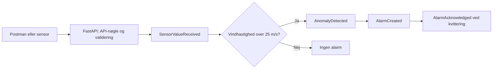

# Intelligent IoT API

En lokal REST API til IoT-overvågning og en MVP til Predictive Maintenance for den fiktive virksomhed **Intelligent IoT Solutions A/S**.

API'et modtager vindhastigheder, finder overskridelser af en fast grænse og opretter alarmer, som kontrolcentret kan kvittere. Målinger, hændelser og alarmer gemmes permanent i SQLite.

> **Status:** Den lokale MVP med database, domænehændelser, API-nøgle og automatiske tests er implementeret. Hele skoleopgaven er endnu ikke færdig: GitHub Actions, Azure-deployment, cloudmonitorering og rapport mangler.

## 1. Hvad virker?

- Modtagelse og validering af sensormålinger.
- Grænsekontrol: vindhastighed **over 25 m/s** udløser en alarm.
- Permanent lagring via SQLAlchemy i tre SQLite-tabeller.
- Gemte domænehændelser fra modtagelse til kvittering.
- Visning af målinger, events samt aktive og kvitterede alarmer.
- API-nøgle i headeren `X-API-Key` på alle dataendpoints.
- Swagger/OpenAPI-dokumentation og grundlæggende logging.
- 37 automatiske tests, som bestod ved seneste testkørsel.

Dette er en tærskelbaseret demonstration. Der bruges endnu ikke maskinlæring til at forudsige fejl.

## 2. Start på din nuværende computer

Åbn projektmappen i VS Code:

```text
C:\Users\Bruger\OneDrive\Desktop\Intelligent-IoT-API
```

Åbn **Terminal → New Terminal**. Brug PowerShell, og kør fra projektmappen:

```powershell
$env:API_KEY = (Get-Content -LiteralPath .env | Where-Object { $_.StartsWith('API_KEY=') }).Substring(8).Trim()
.\.venv\Scripts\python.exe -m uvicorn main:app --reload
```

Første linje henter din eksisterende nøgle fra den lokale `.env`. Anden linje starter serveren. Din `.env` er allerede oprettet på denne computer; den følger ikke med på GitHub.

- API: http://127.0.0.1:8000
- Swagger: http://127.0.0.1:8000/docs
- OpenAPI: http://127.0.0.1:8000/openapi.json

Lad terminalen være åben. Stop serveren med **Ctrl+C**. `--reload` genstarter automatisk serveren ved kodeændringer og er beregnet til lokal udvikling.

Hvis serveren allerede kører og svarer, skal du ikke starte en ekstra kopi. En fejl om, at port 8000 er optaget, betyder normalt, at en anden server allerede bruger porten. En server, der blev startet i baggrunden, stoppes ikke ved Ctrl+C i en anden terminal.

## 3. Installation på en ny computer

Projektet er udviklet med Python 3.13 på Windows. Installér Python, og åbn projektmappen i PowerShell. Det virtuelle miljø `.venv` skal oprettes på ny; det skal ikke kopieres mellem computere.

```powershell
python -m venv .venv
.\.venv\Scripts\python.exe -m pip install -r requirements-dev.txt
```

`requirements.txt` indeholder API'ets pakker. `requirements-dev.txt` tilføjer testpakker. Du behøver ikke aktivere miljøet, når du bruger den fulde sti til Python som ovenfor.

Opret en ny lokal nøgle og en `.env` **kun hvis filen ikke allerede findes**:

```powershell
if (-not (Test-Path -LiteralPath .env)) {
    $newApiKey = (.\.venv\Scripts\python.exe -c "import secrets; print(secrets.token_urlsafe(32))")
    Set-Content -LiteralPath .env -Value "API_KEY=$newApiKey" -Encoding utf8
}
```

Start derefter som beskrevet i afsnit 2. Del ikke `.env`. `.env.example` viser variabelnavnene uden en rigtig nøgle.

### Konfiguration

| Variabel | Betydning |
| --- | --- |
| `API_KEY` | Påkrævet. Mindst 32 tegn uden indledende eller afsluttende mellemrum. |
| `DATABASE_URL` | Valgfri. Standard er SQLite-filen `iot.db` ved siden af `database.py`. |

Programmet indlæser **ikke** `.env` automatisk. Startkommandoen læser kun `API_KEY` fra filen. Hvis du senere ønsker en anden database, skal `DATABASE_URL` sættes som miljøvariabel i terminalen.

## 4. Brug Postman i VS Code

### Den request, du allerede har

Din importerede GET-request til `/readings` virker allerede med API-nøglen. Gem den med **Save**, så du kan bruge den igen. Hvis nøglen ændres, skal requestens header opdateres.

### Opret en request manuelt

1. Åbn Postman, og vælg **New HTTP Request**.
2. Vælg **GET**, og brug `http://127.0.0.1:8000/readings`.
3. Under **Headers** tilføjer du `X-API-Key` som Key.
4. Åbn `.env`, og kopiér kun værdien efter `API_KEY=` ind som Value. Skriv ikke filnavnet `.env` i feltet.
5. Klik **Send**. Forvent **200 OK** og en liste med gemte målinger.

Du kan også bruge **Authorization → API Key** med samme Key og Value og vælge **Header**. Vælg én metode, så du undgår dobbelte headers.

### Lokal collection

`Intelligent-IoT.local.postman_collection.json` indeholder otte færdige requests og den lokale API-nøgle. Filen er udelukket fra Git og må ikke deles. Import via **Import → File** blev afvist i den installerede VS Code-udvidelse. Den enkelte GET-request blev i stedet importeret via cURL og fungerer. Collection-import er derfor ikke en forudsætning for at bruge API'et.

Hvis collectionen kan importeres i din Postman-version, arver requests dens API-nøgle. Request 5 vælger den første aktive alarm, som request 6 kan kvittere. POST og PATCH ændrer data, når de sendes. En ny nøgle i `.env` opdaterer ikke automatisk collectionen.

## 5. Endpoints

Alle URL'er nedenfor har udgangspunkt i `http://127.0.0.1:8000`.

| Metode | Sti | Formål | Succes | API-nøgle |
| --- | --- | --- | --- | --- |
| GET | `/` | Enkel kontrol af, at API'et svarer | 200 | Nej |
| GET | `/docs` | Swagger-testside | 200 | Nej |
| GET | `/openapi.json` | Maskinlæsbar API-beskrivelse | 200 | Nej |
| POST | `/readings` | Gem måling og opret eventuel alarm | 201 | Ja |
| GET | `/readings` | Vis alle målinger | 200 | Ja |
| GET | `/events` | Vis alle domænehændelser i ID-rækkefølge | 200 | Ja |
| GET | `/alarms` | Vis aktive alarmer som standard | 200 | Ja |
| GET | `/alarms?status=acknowledged` | Vis kvitterede alarmer | 200 | Ja |
| GET | `/alarms?status=all` | Vis hele alarmhistorikken | 200 | Ja |
| PATCH | `/alarms/{alarm_id}/acknowledge` | Kvittér en eksisterende alarm | 200 | Ja |

Swagger: Klik **Authorize**, indsæt din nøgle, og brug derefter **Try it out → Execute**.

### Send en måling

I Postman vælger du **POST** til `/readings`, **Body → raw → JSON**, og sender:

```json
{
  "device_id": "WT-01",
  "wind_speed": 30
}
```

Eksempel på svar; ID og tidspunkt varierer:

```json
{
  "created_at": "2026-11-09T09:48:07.329210+00:00",
  "id": 1,
  "device_id": "WT-01",
  "wind_speed": 30.0,
  "anomaly_detected": true
}
```

`device_id` skal indeholde mindst ét tegn, som ikke er whitespace, og må højst være 100 tegn. `wind_speed` skal være en endelig numerisk værdi fra 0 til 80 m/s. Præcis 25 m/s giver ingen alarm; 30 m/s gør.

### Kvittér en alarm

Find ID'et med `GET /alarms`. Send derefter eksempelvis:

```text
PATCH http://127.0.0.1:8000/alarms/1/acknowledge
```

Ingen body er nødvendig. Erstat `1` med det aktuelle alarm-ID. Svaret indeholder `status: acknowledged` og `acknowledged_at`. Kvittering betyder, at alarmen er set; det betyder ikke, at fejlen er repareret. En gentaget kvittering opretter ikke endnu en hændelse.

### Fejl, du kan møde

| Resultat | Forklaring |
| --- | --- |
| 401 | API-nøglen mangler eller er forkert. |
| 404 | Alarm-ID'et findes ikke. |
| 422 | Input er ugyldigt, eksempelvis negativ vindhastighed eller en ukendt status. |
| 503 | En databasehandling fejlede. Svaret viser ikke interne databasedetaljer. |
| Connection refused | Serveren kører ikke, eller adressen/porten er forkert. |
| Opstart fejler med `API_KEY` | Sæt nøglen i terminalen som vist i afsnit 2. |

## 6. Domæne, arkitektur og database



Hændelserne gemmes som rækker i databasen; der er ingen ekstern beskedkø. Forretningsreglen findes som `THRESHOLD = 25` i `main.py`. Hver måling over grænsen opretter sin egen alarm, også når samme installation allerede har en aktiv alarm.

| Tabel | Indhold og relationer |
| --- | --- |
| `sensor_readings` | Målingens ID, installation, vindhastighed, afvigelsesresultat og tidspunkt. |
| `alarms` | Alarmens ID, unik reference til målingen, installation, besked, status og tidspunkter. |
| `domain_events` | Hændelsens ID, type, reference til måling, eventuel reference til alarm, JSON-data og tidspunkt. |

`reading_id` binder flowet sammen. `alarm_id` er tomt på hændelser uden alarmreference. Tidspunkter vises i UTC med `+00:00`.

En måling, dens events og eventuelle alarm gemmes i **én transaktion**: enten gemmes alt, eller også rulles hele handlingen tilbage. SQLAlchemy bruger parameteriseret databaseadgang. SQLite-fremmednøgler er slået til.

`iot.db` oprettes ved opstart og overlever servergenstart. Åbn den med et SQLite-værktøj, hvis du vil undersøge tabellerne; den er ikke en almindelig tekstfil. Undlad at slette filen, hvis du vil bevare data. De tidligere Python-lister er erstattet af databasen; gamle listeværdier kan ikke genskabes efter genstart.

## 7. Projektfiler

```text
Intelligent-IoT-API/
├── main.py                      # API, validering, API-nøgle og domæneflow
├── database.py                  # SQLAlchemy-tabeller og databaseforbindelse
├── tests/
│   └── test_api.py               # Automatiske tests med separate databaser
├── requirements.txt             # Pakker til API'et
├── requirements-dev.txt         # Pakker til udvikling og test
├── README.md                    # Denne vejledning
├── .env.example                 # Konfigurationseksempel uden hemmeligheder
├── .gitignore                   # Udelukker lokale data og hemmeligheder
├── .env                         # Lokal nøgle; må ikke deles
├── iot.db                       # Lokal database; må ikke lægges på GitHub
└── Intelligent-IoT.local.postman_collection.json  # Lokal privat collection
```

`.venv`, cachefiler, `.env`, SQLite-databasefiler og den private Postman-collection er udelukket fra Git.

## 8. Automatiske tests

Kør fra projektmappen:

```powershell
.\.venv\Scripts\python.exe -m pytest -q
```

Seneste verificerede resultat: **37 passed**. Testene bruger deres egen testnøgle og midlertidige SQLite-filer; du behøver ikke starte serveren eller sætte din rigtige nøgle først. Din `iot.db` berøres ikke.

Testene dækker normale målinger, grænseværdier, ugyldigt input, events, alarmrelationer, kvittering, gentaget kvittering, permanent lagring efter genåbning, rollback ved databasefejl, manglende/forkert nøgle, manglende konfiguration og OpenAPI-sikkerhedsbeskrivelsen.

Den installerede Starlette-version giver en deprecation-advarsel om httpx i testklienten. Det er en advarsel om en fremtidig ændring; de 37 tests bestod med de installerede versioner.

### Hvis Windows blokerer SQLAlchemy

På denne computer blokerede programkontrol den kompilerede SQLAlchemy-udvidelse. Pakken blev derfor installeret som ren Python. Hvis samme fejl opstår ved geninstallation:

```powershell
$env:DISABLE_SQLALCHEMY_CEXT = '1'
.\.venv\Scripts\python.exe -m pip install --force-reinstall --no-binary SQLAlchemy SQLAlchemy==2.1.8
```

Dette ændrer ikke Windows' sikkerhedsindstillinger.

## 9. Forslag til demonstration på cirka fem minutter

1. Forklar problemet: høj vindhastighed skal opdages, så kontrolcentret kan reagere.
2. Send 20 m/s og derefter 30 m/s. Vis forskellen i `anomaly_detected`.
3. Vis `/events` og sammenhængen via `reading_id`.
4. Vis den aktive alarm, kvittér den, og vis historikken.
5. Vis, at data stadig findes efter servergenstart, og fremvis testresultatet.

Du behøver ikke gentage alle manuelle tests ved hver opstart. Gem dine requests til demonstrationen; brug de automatiske tests ved kodeændringer.

## 10. Hvad mangler før den samlede aflevering?

| Område | Status og næste arbejde |
| --- | --- |
| Lokal API og SQLite | Implementeret og testet. |
| Domænehændelser og kvittering | Implementeret og testet. |
| API-nøgle | Implementeret; én fælles nøgle giver samme rettigheder til alle. |
| Rate limiting | Ikke implementeret. |
| GitHub | Repository og publicering er ikke opsat som del af arbejdet her. |
| CI/CD | GitHub Actions-workflows er ikke oprettet. |
| PostgreSQL | Generelle SQLAlchemy-typer er anvendt; driver, migreringer og PostgreSQL-test mangler. |
| Azure | Ingen ressourcer oprettet og ingen deployment udført. App Service, PostgreSQL, HTTPS og hemmelighedshåndtering skal opsættes efter godkendelse. |
| Monitorering | Grundlæggende lokal logging findes. Application Insights/Azure Monitor mangler. |
| Rapport | PDF på 5–7 sider skal udarbejdes. |

Før offentlig drift bør løsningen desuden få databasemigreringer, pagination på lister, en backupplan og en vurdering af adgangsrettigheder og belastningsbegrænsning. `create_all` opretter manglende tabeller, men opdaterer ikke strukturen i eksisterende tabeller.

Serveren lytter som standard kun på denne computer. Adressen `127.0.0.1` giver ikke adgang fra en anden computer. Den offentlige HTTPS-adgang hører til den senere deployment.

Der er ikke oprettet betalingsressourcer eller udført deployment. Azure-ressourcer og deployment kræver din godkendelse.
